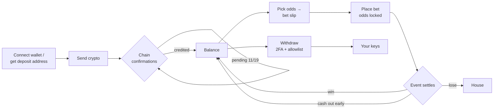
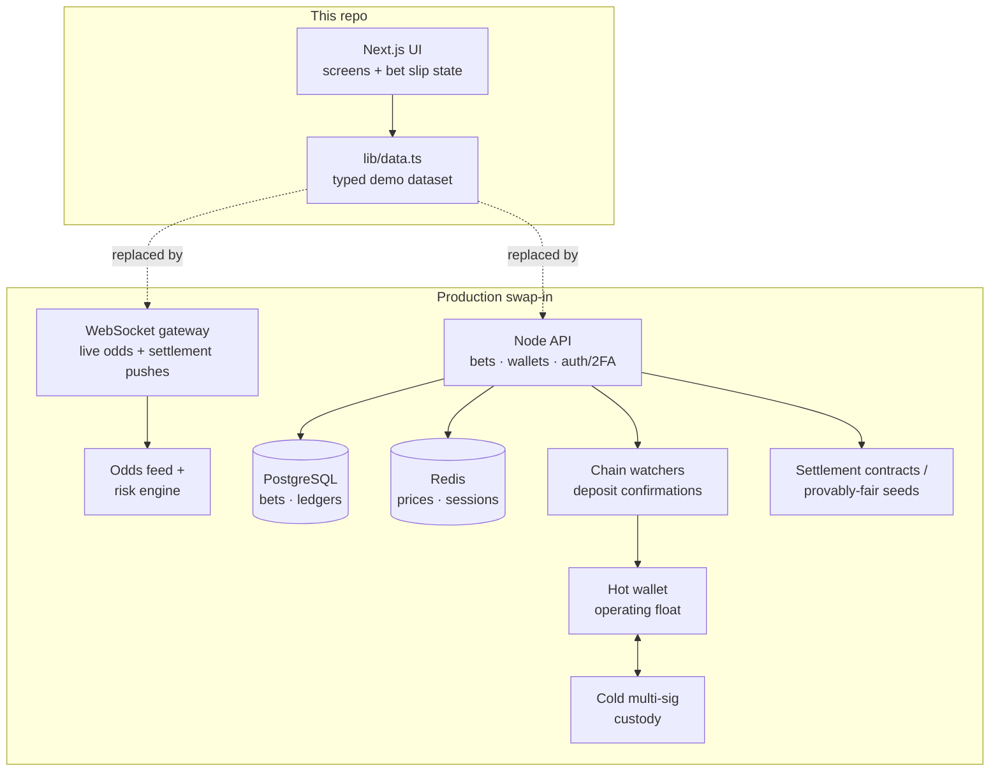

# Betrium — Crypto Sportsbook & Casino

**A SaaS-grade betting platform UI: live odds, a working bet slip, provably-fair casino, multi-chain wallet — bet in crypto, settle on-chain.**

`Next.js 15` · `React 19` · `TypeScript` · `Tailwind CSS v4` · `static export` · fully responsive (desktop icon rail → mobile floating bottom bar)


---

## Product tour

### 1 · Marketing landing

First touch: a luxury gold-on-graphite register, with a live-odds ticker fed by the same dataset as the app — the marketing page and the product never disagree.


### 2 · Sportsbook

The odds board. Sport / league / period filters, an Upcoming–Live segmented toggle, and match cards that carry a live score, an implied win-probability sparkline and tap-to-select 1X2 prices. Selecting a price turns it gold and opens the bet slip; combined odds and potential payout recompute on every keystroke of the stake field. Multiple selections become a parlay automatically, and picking a second outcome in the same market replaces the first — one pick per market, like a real book.

### 3 · Match detail

A drill-down with breadcrumb, LIVE minute + score pill, team summary cards and six content tabs — Overview, Markets, Statistics, Timeline, Head-to-Head, My Bets. Markets carry open/suspended states; suspended prices can't be added to the slip.


### 4 · Casino

Originals and live tables. Every card states its RTP, max win and fairness model up front — the transparency *is* the pitch.


### 5 · Game detail — provably fair

The crash game page shows the commit–reveal loop in the UI: hashed server seed, editable client seed, per-round nonce, and a one-click local verification of the last round. Limits (min/max bet, max win, house edge) are a first-class tab, not fine print.

### 6 · Wallet

Per-asset balance cards (BTC, ETH, SOL, USDT) with 24h sparklines and in-bets/pending splits, a deposit panel with address + QR and per-chain confirmation rules, a withdraw flow gated by 2FA, and a transaction list with pending `11 / 19` confirmation counters.


### 7 · Mobile

The icon rail becomes a floating bottom bar; the bet slip docks as a sheet above it. Every route is overflow-free at 390 px.


---

## How the platform works

### The money loop

Everything in the UI hangs off one loop — crypto in, bets through, crypto out:



Each state in that loop is a visible UI state, not an abstraction:

| Loop stage | Where you see it |
|---|---|
| Deposit pending | Wallet tx list — amber `Pending · 11 / 19` pill counting confirmations per chain (BTC 2, ETH 12, SOL 32, TRC-20 19) |
| Odds locked at slip time | Bet slip note "Odds may change before confirmation"; My Bets stores the taken price |
| Live settlement | Sportsbook LIVE pills, in-play prices, suspended markets while the book re-prices |
| Early exit | "Cashout available" on every eligible card; `Cashed out` bets show the realised payout |
| Withdrawal safety | Settings → Security: 2FA required per withdrawal, address allowlist with 24 h hold |

### Provably fair, in one paragraph

Before a round starts the server **commits** to its randomness by publishing `SHA-256(server seed)`. The outcome is then derived from `server seed + client seed + nonce` — the player controls the client seed, the nonce increments per round, so neither side can steer a result after the commitment. When the seed rotates, the old server seed is **revealed** and any past round can be recomputed locally. The game-detail page walks a client through exactly this: hash → seeds → "Verify last round".

### Responsible play as product surface

Deposit/loss limits, session reminders and self-exclusion live in Settings as first-class controls — the compliance surface regulators and payment partners look for, designed instead of hidden.

### Demo architecture vs. production

This repository is the **frontend showcase**: every screen is a React client component over a typed demo dataset (`lib/data.ts`), so the whole product ships as a static export with zero backend — ideal for a portfolio host. The dataset is crafted to behave like real book output: prices carry a ~5 % overround, derivative markets are derived from the 1X2 probabilities (nothing below 1.01), USD equivalents match quoted spot prices, and confirmation counts match each chain.

The UI's seams are where a production backend plugs in:



The mapping is deliberately one-to-one: match cards re-render from a WebSocket price stream instead of `matches[]`; the bet slip POSTs to a bet-placement endpoint that locks the quoted price; the wallet's pending pill reads the chain watcher's confirmation events; the fairness panel reads real seed commitments. No screen needs redesigning to go live — only its data source changes.

---

## Design system

Built with the **properui** template method: a real product's layout anatomy (app shell, card grammar, drill-downs, filter bars) re-skinned to a new brand — so the result reads like a shipped product, not a generated page.

| Token | Value | Used for |
|---|---|---|
| ground | `#0D0E10` on `#070809` frame | app canvas on darker page ground |
| surface / surface2 | `#161719` / `#1E2025` | cards (1 px hairline borders — no shadows on dark) |
| ink / muted | `#F4F1EA` / `#8C8B88` | text hierarchy |
| accent | `#D4A94E` gold | CTAs, selected odds, active nav |
| accent2 | `#8B7445` bronze | secondary tags |
| win / loss / warn | `#4CC38A` / `#E5696D` / `#E8B44C` | settled states, LIVE, pending |
| display / body | Cinzel / Inter | uppercase page titles & card titles / UI text, `tabular-nums` for every odd and amount |

Interaction details that make it feel real: gold selected state and press-scale on odds buttons, `/` focuses global search, visible `:focus-visible` rings, `prefers-reduced-motion` respected, reveal-on-scroll that never replays, and layout-shift-free sparklines (fixed-viewBox inline SVG).

---

## Running it

```bash
npm install
npm run dev          # http://localhost:3000
npm run build        # static export in out/ — host on Vercel / Netlify / GitHub Pages
```

Routes: `/` · `/sportsbook` · `/live` · `/sportsbook/[match]` · `/casino` · `/casino/[game]` · `/wallet` · `/bets` · `/settings`

## Repository map

- `LAYOUT.md` — the template inventory and template → Betrium screen mapping
- `DESIGN.md` — the build brief and token derivation
- `app/globals.css` — every design token; components never hardcode a colour
- `lib/data.ts` — the demo dataset (odds, games, assets, bets) with its consistency rules
- `components/screens/` — one component per screen · `components/ui.tsx` shared primitives · `components/bet-slip.tsx` slip state + panel
- `design-reference/` — the reference imagery the layout was reproduced from
- `screenshots/` — the captures embedded above

---

*Betrium is a fictional brand built as a portfolio demonstration. All market, balance and transaction data is demo data. 18+ · play responsibly.*
