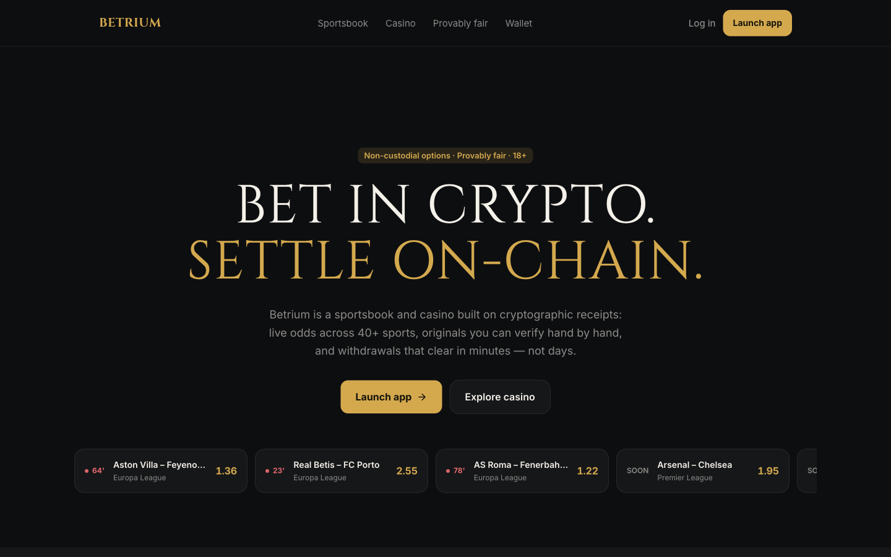
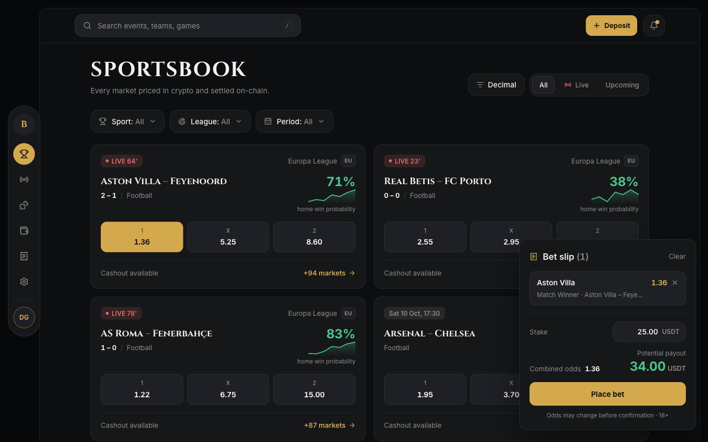
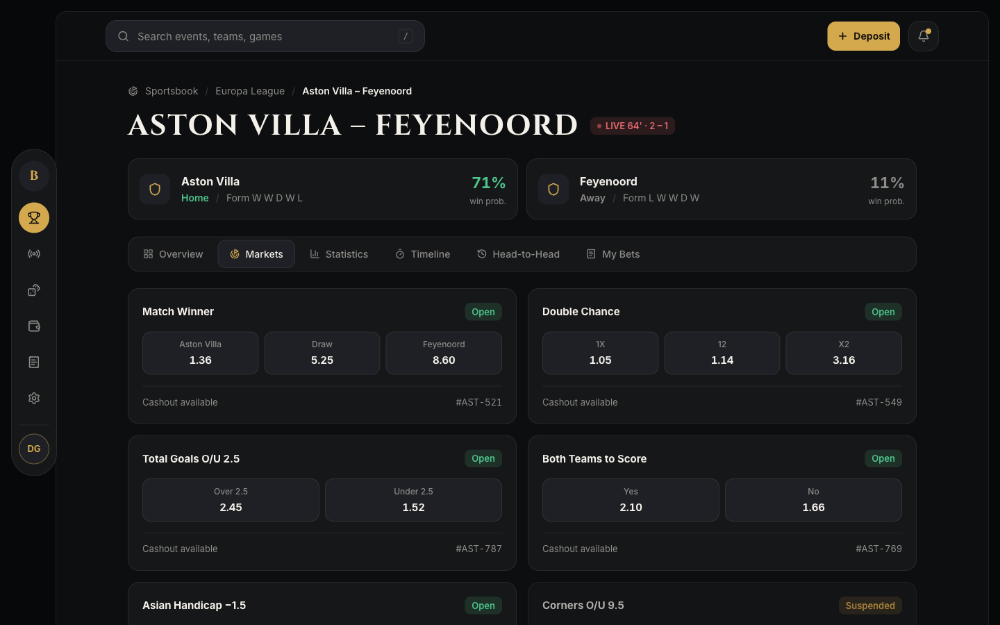
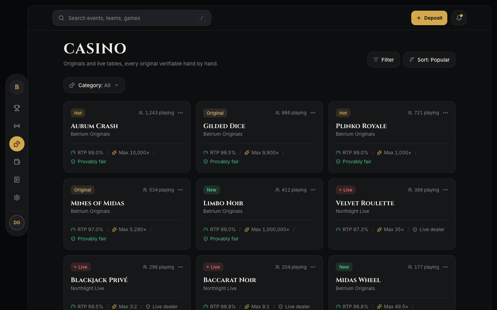
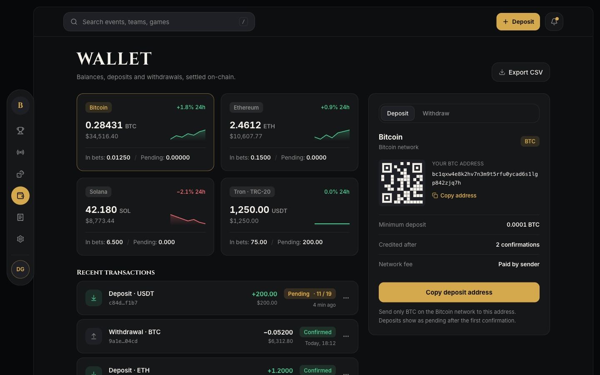
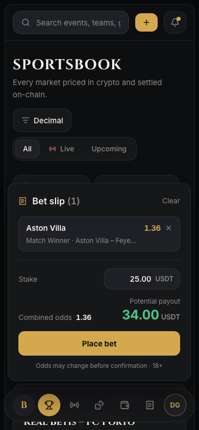

# Betrium — Crypto Sportsbook & Casino (portfolio showcase)

A SaaS-grade crypto betting platform UI: live-odds sportsbook with a working bet
slip, provably-fair casino, multi-chain wallet, bet history and settings, plus a
marketing landing page. Dark gold-on-graphite design system, fully responsive
(floating icon rail on desktop, floating bottom bar on mobile).

Built as a re-skin of a real product template (see `DESIGN.md` and `LAYOUT.md`);
all data in `lib/data.ts` is demo data, crafted to be internally consistent —
odds carry a real overround, USD equivalents match quoted prices, confirmation
counts match each chain.

```bash
npm install
npm run dev          # http://localhost:3000
npm run build        # static export in out/
```

## Screenshots

**Marketing landing** — Cinzel display hero with the live-odds ticker pulled from the same dataset as the app.



**Sportsbook** — live and prematch cards with win-probability sparklines; clicking a price selects it (gold state) and opens the bet slip with combined odds and payout computed live.



**Match detail** — breadcrumb drill-down, live score pill, team summary cards, six content tabs and a market grid with open/suspended states.



**Casino** — game grid with category filter, per-game RTP, max win and provably-fair badges, plus pagination.



**Wallet** — per-asset balance cards with sparklines, a deposit panel with generated QR and per-chain confirmation rules, and transaction history with pending/confirmed states.



**Mobile** — the icon rail becomes a floating bottom bar and the bet slip docks as a sheet above it; every screen is overflow-free at 390 px.



## Screens

| Route | What it shows |
|---|---|
| `/` | Marketing landing — hero, live ticker, feature blocks, stats, security, footer |
| `/sportsbook` | Odds board: sport/league filters, live + prematch match cards, 1X2 odds, bet slip |
| `/sportsbook/[slug]` | Match detail: summary cards, 6-tab strip, market grid, live timeline |
| `/casino` | Game grid with category filter and pagination |
| `/casino/[slug]` | Game detail: crash panel, provably-fair hash verify, recent rounds, limits |
| `/wallet` | Asset balances with sparklines, deposit/withdraw panel with QR, tx history |
| `/bets` | Bet history with status/type filters |
| `/settings` | Profile, security (2FA), sessions, responsible-play limits |

## What is here

- `DESIGN.md` — the brief. Read it before changing anything visual.
- `LAYOUT.md` — the template inventory and the template → Betrium screen mapping.
- `app/globals.css` — every design token. Change values here, not in components.
- `lib/tokens.ts` — the same tokens for canvas and chart code.
- `lib/data.ts` — all demo data (matches, markets, games, assets, bets).
- `components/screens/` — one component per screen; `components/ui.tsx` shared primitives.
- `design-reference/` — the reference imagery this direction came from.

## Deploying

`next build` writes a fully static site to `out/` (`output: "export"`), so it
hosts anywhere: Vercel, Netlify, GitHub Pages, any static bucket. For GitHub
Pages under a subpath, set `basePath` in `next.config.mjs` first.
